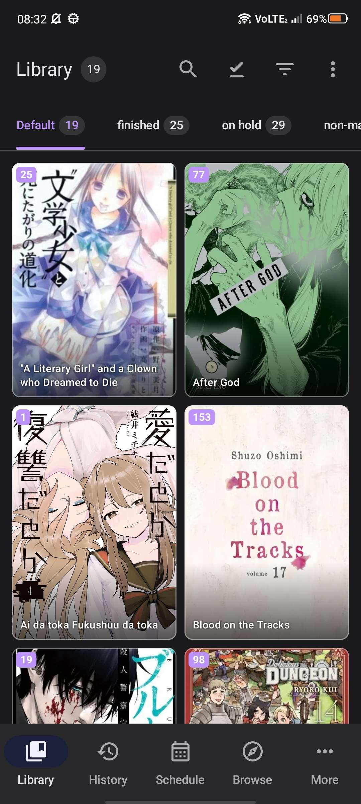
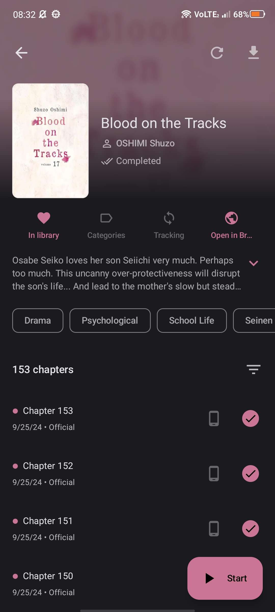

<div align="center">
  
  <br />
  
  <p><code>suwayomi-server</code> &middot; <code>graphql</code> &middot; <code>jetpack compose</code> &middot; <code>no legacy bloat</code></p>
</div>

## screenshots

| library | entry | reader |
| :---: | :---: | :---: |
|  |  |  |

## what it does / why it's different

- **server-first.** direct suwayomi-server integration via graphql, with no local extensions or backups to manage.
- **no legacy bloat.** drops tachiyomi-family backward compatibility and local sqlite duplication for faster library syncs and lower overhead.
- **per-entry filters.** filter by scanlator, read/download/bookmark state, and sort order—all saved on the server so it syncs across devices.
- **dual-origin support.** set a primary lan url and a fallback url (for wireguard/tailscale) with origin-bound credential isolation.
- **dynamic accents.** pulls m3 color palettes from series covers, with full offline chapter downloads and tracker support.

## requirements

- **android 8.0+.**
- **suwayomi-server 2.4.2366+ with graphql enabled.**

## install / building

grab the latest apk from [releases](https://github.com/tristitious/bunko/releases), or build it yourself:

```bash
git clone https://github.com/Suwayomi/Suwayomi-Bunko.git
cd Suwayomi-bunko
./gradlew assembleRelease
```

the apk outputs to `android/build/outputs/apk/release/android-release.apk`.

## credits

- **[suwayomi-jui](https://github.com/Suwayomi/Suwayomi-JUI)** — primary graphql client & compose foundation
- **[suwayomi-tsumiru](https://github.com/Suwayomi/Suwayomi-Tsumiru)** — ui & feature inspiration
- **[komikku](https://github.com/komikku-app/komikku)** — reader & cover-accent design cues
- **[suwayomi-server](https://github.com/Suwayomi/Suwayomi-Server)** — backend server

## license

[LICENSE](LICENSE)
